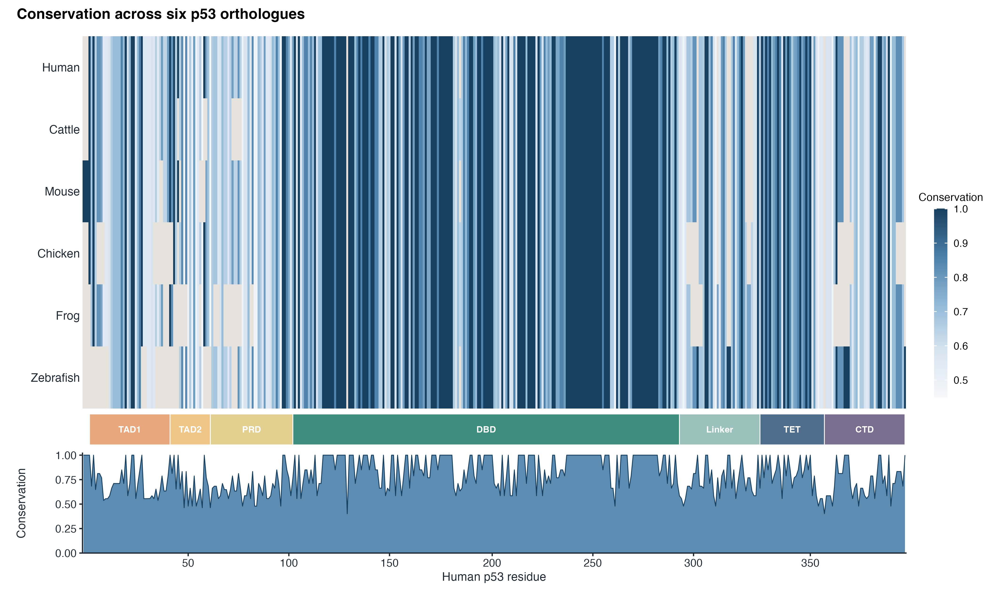
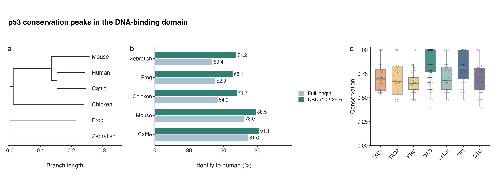
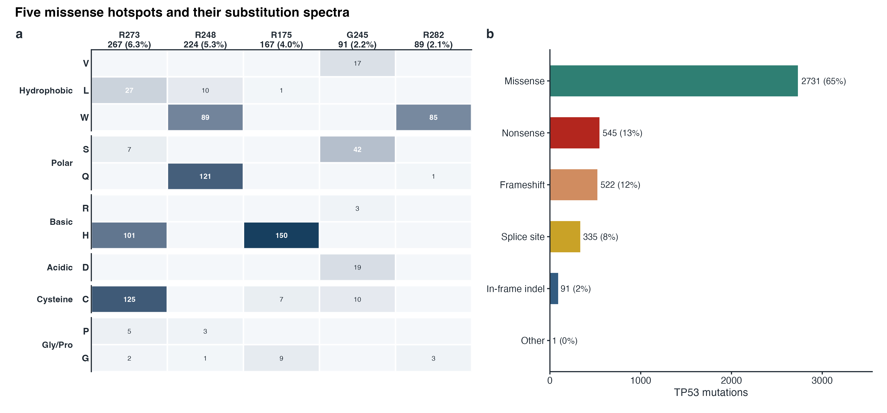
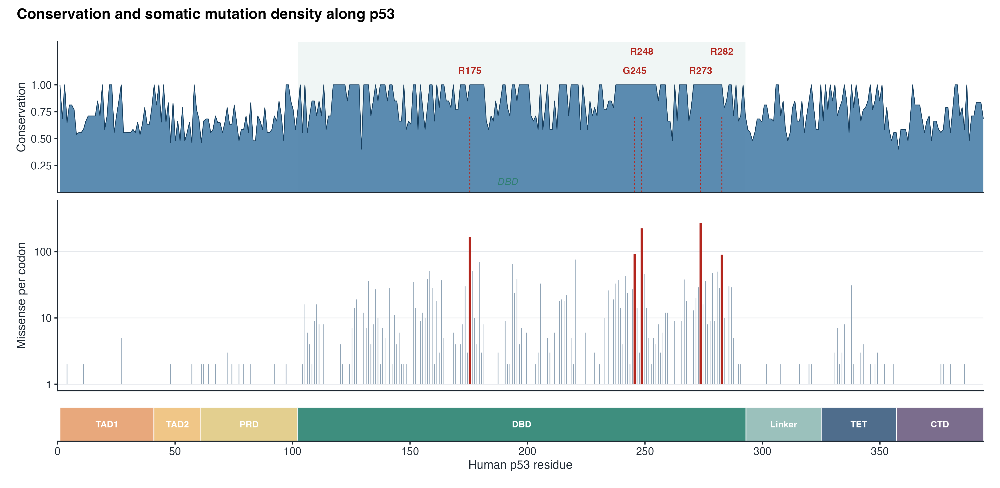
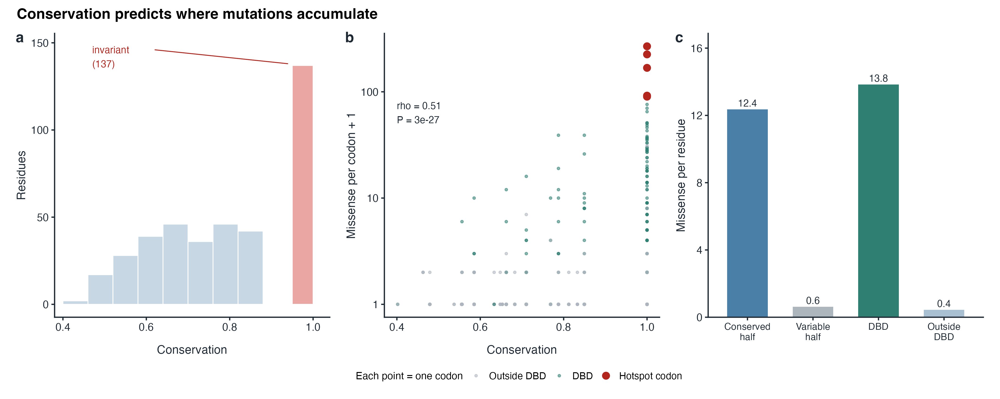
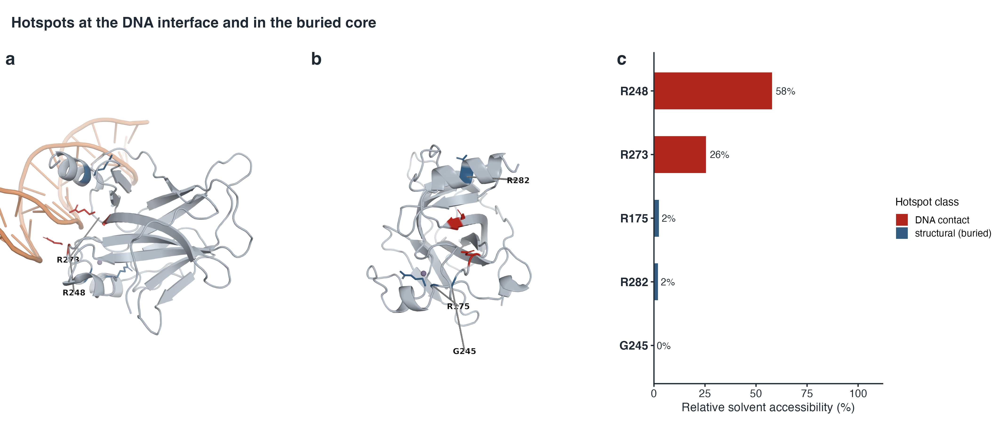

# TP53 的演化与癌症突变

**PEAD7902 — 作业一**  ·  Min Li（3036744858）  ·  2026 年 10 月

## 摘要

TP53 是突变频率最高的抑癌基因。本文比对 6 种脊椎动物的 p53 直系同源序列，定量计算逐残基保守性，并把 32 个 TCGA 泛癌队列、3,839 例肿瘤中的 4,225 个体细胞 TP53 突变映射到序列比对与核心结构域结构上。DNA 结合结构域最为保守（平均得分 0.88，其余 0.72）。R273、R248、R175、G245 与 R282 五个密码子承载 19.8% 的全部突变；五者在 6 个物种中完全不变，分别位于 DNA 界面（R248、R273）或埋藏核心（R175、G245、R282）。保守性与突变密度呈正相关（Spearman ρ = 0.51）。癌症突变集中于演化上不变的残基，但保守性本身不能决定哪些密码子成为热点。

## 要点

- DBD 是 p53 的保守核心：57% 残基完全不变，其余区域仅 14%。
- R273、R248、R175、G245、R282 占全部 TP53 突变的 19.8%。
- 五者在脊椎动物中均完全不变。
- 两种机制：DNA 接触丧失（R248、R273）与核心去稳定（R175、G245、R282）。
- 保守性预测功能重要性，而非突变频率。

## 结果

### 六种脊椎动物的 p53：保守的 DNA 结合结构域

从 UniProt 取得人、牛、鼠、鸡、蛙、斑马鱼 6 种脊椎动物的全长 p53 [1]，用 Clustal Omega 比对 [2,3]（图 1）。与人一致性由哺乳动物约 80% 降至鸡、蛙、斑马鱼的约 50–55%，但 DNA 结合结构域（DBD，102–292 位）[4–6] 仍达 68–91%（图 2、表 1）；DBD 平均保守性 0.88，其余区域 0.72。

**图 1.** 六种 p53 直系同源序列的多重比对。 每个格子按该比对列的保守性着色（越深越保守），米色格子为比对空位。DBD 明显比两端区域更暗。六条序列由 Clustal Omega 比对。

**图 2.** 跨物种与跨结构域的保守性。 (a) Clustal Omega 指导树。(b) 与人 p53 的全长一致性及 DBD 内一致性。(c) 各结构域的保守性分布。

**表 1. 所用序列及与人 p53 的一致性。**

| 物种 | UniProt | 长度（aa） | 全长一致性 | DBD（102–292）一致性 |
|---|---|---|---|---|
| *Homo sapiens*（人） | P04637 | 393 | 100.0% | 100.0% |
| *Bos taurus*（牛） | P67939 | 386 | 81.6% | 91.1% |
| *Mus musculus*（鼠） | P02340 | 390 | 78.0% | 88.5% |
| *Gallus gallus*（鸡） | P10360 | 367 | 54.9% | 71.7% |
| *Xenopus laevis*（蛙） | P07193 | 363 | 52.9% | 68.1% |
| *Danio rerio*（斑马鱼） | P79734 | 373 | 50.4% | 71.2% |

### 五个突变热点

32 个 TCGA 泛癌队列 [7]、3,839 例肿瘤共 4,225 个体细胞 TP53 突变（cBioPortal [8,9]；65% 错义）中，错义突变数最多的五个密码子（R273、R248、R175、G245、R282）占全部突变的 19.8%、错义突变的 30.7%（图 3、表 2）。每位点仅少数替换：R175H（90%）、R282W（96%）、R248Q/W（54/40%）、R273C/H（47/38%）、G245S（46%）。

**图 3.** 五个热点及其替换谱。 (a) 热点密码子（列）与突变残基（行，按残基类别分组）的矩阵；格子颜色深浅与数字表示该替换的例数，列标签给出该密码子的总数及其占全部 TP53 突变的百分比。(b) 全部 4,225 个 TP53 突变的后果类型。

**表 2. 五个主要 TP53 热点（TCGA 泛癌队列，cBioPortal）。**

| 密码子 | 主要替换（占该密码子 %） | 例数 | 占全部 TP53 突变 | 保守性 | 结构角色 | 结构证据（1TUP） |
|---|---|---|---|---|---|---|
| R273 | C 47，H 38，L 10 | 267 | 6.3% | 1.00 | DNA 接触 | 距 DNA 2.5 Å |
| R248 | Q 54，W 40，L 4 | 224 | 5.3% | 1.00 | DNA 接触 | 距 DNA 2.3 Å |
| R175 | H 90，G 5，C 4 | 167 | 4.0% | 1.00 | 结构残基（埋藏） | 可及表面 2% |
| G245 | S 46，D 21，V 19，C 11 | 91 | 2.2% | 1.00 | 结构残基（埋藏） | 可及表面 0% |
| R282 | W 96，G 3 | 89 | 2.1% | 1.00 | 结构残基（埋藏） | 可及表面 2% |

### 热点位于演化上完全不变的残基

五个热点在 6 种脊椎动物中完全不变且均在 DBD；随机五个密码子全不变的概率 *P* = 0.005。突变密度随保守性升高：DBD 内每残基 13.8 个错义突变，DBD 外 0.4 个（图 4、图 5）。在 1TUP 结构 [4] 中，R248、R273 接触 DNA 骨架（2.3–2.5 Å），R175、G245、R282 埋藏于核心（可及表面 0–2%）（图 6）。

**图 4.** p53 沿序列的保守性与突变密度。 上：逐残基保守性，阴影为 DBD；下：各密码子的错义突变数（对数坐标），热点标红；最下方为结构域示意图。

**图 5.** 保守性预测突变富集的位置。 (a) 保守性分布；五个热点全部落在完全不变的那一类（137 个残基）。(b) 保守性与错义突变密度（Spearman ρ = 0.51，*P* = 3×10⁻²⁷）；每点为一个密码子，灰色为 DBD 外残基，蓝绿色为 DBD 内残基，红色为五个热点密码子。(c) 保守半区与可变半区、DBD 内与 DBD 外每个残基的突变数。

**图 6.** 热点的结构环境。 (a) p53 核心结构域（PDB 1TUP）与 DNA 复合物的界面视图，棍状模型标出 DNA 接触热点 R248 与 R273（红色）。(b) 旋转视图并隐藏 DNA，显示埋藏的结构性热点 R175、G245、R282（蓝色）；Zn²⁺ 为紫色球。(c) 各热点的相对溶剂可及性，可区分埋藏的核心残基与接触 DNA 的残基。

## 讨论

### 保守性对疾病突变的启示

保守性标记出化学性质不可更改的残基，肿瘤恰好选择这些位点：跨物种的纯化选择与肿瘤中的正选择汇聚于同一 DNA 界面和一个折叠核心。但保守性并不充分：137 个残基完全不变，仅少数成为热点，因此保守性本身不能决定哪些不变残基成为热点。

### 大规模数据库如何帮助识别功能残基

大规模数据库把零散观察转化为统计证据：本文使用的 cBioPortal 汇集数千例肿瘤，使单密码子的高频复发可与 passenger（伴随）突变背景区分；COSMIC 提供跨癌种体细胞突变 [10]，IARC TP53 数据库 [11] 补充胚系变异与功能实验，可作为独立交叉验证资源。本文数据显示，突变集中于少数密码子，这些密码子跨物种不变，对应残基或接触 DNA、或稳定核心。因此交叉比对频率、保守性、结构与实验数据，可识别功能重要残基并区分驱动与伴随突变。局限仍存：队列构成与测序深度影响代表性；indel 常被低估。

## 方法

从 UniProt 下载 6 条审阅条目（P04637、P02340、P67939、P10360、P07193、P79734）[1]，经 EMBL-EBI 的 Clustal Omega 1.2.4 比对 [2,3]，得到 409 列的比对结果。

保守性按比对列计算 Shannon 熵 [12]，得分 = 1 − H/log₂20；同时计算 Jensen–Shannon 散度 [13] 及与人序列的一致性，并映射到人 p53 残基编号。

通过 cBioPortal REST API 获取 32 个 TCGA 泛癌队列中全部 TP53（Entrez 7157）突变 [8,9]，去重后得到 4,225 个事件、3,839 例样本；热点按错义突变数排序。

采用超几何检验评估热点在不变密码子中的富集，用 Mann–Whitney U 检验比较热点与其他密码子的保守性，用 Spearman 相关分析保守性与突变密度的关系。

从 PDB 1TUP [4] 中自动选取与 DNA 接触最多的核心结构域；用 Biopython 计算 Shrake–Rupley 溶剂可及性 [14]，残基最大可及表面积取自 Tien 等 [15]。

结构域边界采用以 UniProt 为锚的划分：DBD 102–292 与 TET 325–356 取自 UniProt [1]；TAD1（1–40）与 TAD2（41–60）沿用常规示意，PRD（61–101）覆盖富含脯氨酸区域及其至 DBD 起点之间的相邻片段，Linker（293–324）与 CTD（357–393）补齐其余区域。1TUP 解析的核心结构域 [4] 是该 DBD 的结构对应区域。分析使用 Python 3.9.6（Biopython 1.85、NumPy 2.0.2）与 R 4.6.1（ggplot2 4.0.3、patchwork 1.3.2）；图 6a,b 使用开源 PyMOL 3.2.0.2 渲染；cBioPortal API 访问日期为 2026-10-25。

## 数据可用性

本文分析的数据均为公开数据：蛋白序列来自 UniProtKB（P04637、P02340、P67939、P10360、P07193、P79734）；体细胞突变来自 cBioPortal REST API（TCGA 泛癌队列 32 项研究，访问日期 2026-10-25）；结构来自 PDB（1TUP）。派生数据（序列比对、逐残基保守性、逐密码子突变数、热点与结构指标、图 5 与图 6 的源数据）已整理至 GitHub 仓库 https://github.com/WhyLIM/HKU-PEAD7902。未上传 cBioPortal 的原始 JSON 缓存（约 3.4 MB），运行 scripts/04_fetch_mutations.py 可重新获取。

## 代码可用性

分析代码见 GitHub 仓库 https://github.com/WhyLIM/HKU-PEAD7902。完整复现步骤与文件说明见仓库 README。

## 声明

本研究过程中使用了生成式人工智能工具，包括但不限于实验设计、代码编写与计算方法。所有环节均经本人人工审核与核对。

## 参考文献

1. UniProt Consortium. UniProt: the Universal Protein Knowledgebase in 2025. *Nucleic Acids Res*. 2025;53(D1):D609–D617. doi:10.1093/nar/gkae1010

2. Sievers F, Wilm A, Dineen D, Gibson TJ, Karplus K, Li W, et al. Fast, scalable generation of high-quality protein multiple sequence alignments using Clustal Omega. *Mol Syst Biol*. 2011;7(1):539. doi:10.1038/msb.2011.75

3. Madeira F, Pearce M, Tivey ARN, Basutkar P, Lee J, Edbali O, et al. Search and sequence analysis tools services from EMBL-EBI in 2022. *Nucleic Acids Res*. 2022;50(W1):W276–W279. doi:10.1093/nar/gkac240

4. Cho Y, Gorina S, Jeffrey PD, Pavletich NP. Crystal structure of a p53 tumor suppressor-DNA complex: understanding tumorigenic mutations. *Science*. 1994;265(5170):346–355. doi:10.1126/science.8023157

5. Joerger AC, Fersht AR. Structural biology of the tumor suppressor p53. *Annu Rev Biochem*. 2008;77(1):557–582. doi:10.1146/annurev.biochem.77.060806.091238

6. Kastenhuber ER, Lowe SW. Putting p53 in context. *Cell*. 2017;170(6):1062–1078. doi:10.1016/j.cell.2017.08.028

7. Hoadley KA, Yau C, Hinoue T, Wolf DM, Lazar AJ, Drill E, et al. Cell-of-origin patterns dominate the molecular classification of 10,000 tumors from 33 types of cancer. *Cell*. 2018;173(2):291–304.e6. doi:10.1016/j.cell.2018.03.022

8. Cerami E, Gao J, Dogrusoz U, Gross BE, Sumer SO, Aksoy BA, et al. The cBio cancer genomics portal: an open platform for exploring multidimensional cancer genomics data. *Cancer Discov*. 2012;2(5):401–404. doi:10.1158/2159-8290.CD-12-0095

9. de Bruijn I, Kundra R, Mastrogiacomo B, Tran TN, Sikina L, Mazor T, et al. Analysis and visualization of longitudinal genomic and clinical data from the AACR Project GENIE Biopharma Collaborative in cBioPortal. *Cancer Res*. 2023;83(23):3861–3867. doi:10.1158/0008-5472.CAN-23-0816

10. Sondka Z, Dhir NB, Carvalho-Silva D, Jupe S, et al. COSMIC: a curated database of somatic variants and clinical data for cancer. *Nucleic Acids Res*. 2024;52(D1):D1210–D1217. doi:10.1093/nar/gkad986

11. Bouaoun L, Sonkin D, Ardin M, Hollstein M, Byrnes G, Zavadil J, et al. TP53 variations in human cancers: new lessons from the IARC TP53 database and genomics data. *Hum Mutat*. 2016;37(9):865–876. doi:10.1002/humu.23035

12. Shannon CE. A mathematical theory of communication. *Bell Syst Tech J*. 1948;27(3):379–423. doi:10.1002/j.1538-7305.1948.tb01338.x

13. Lin J. Divergence measures based on the Shannon entropy. *IEEE Trans Inf Theory*. 1991;37(1):145–151. doi:10.1109/18.61115

14. Shrake A, Rupley JA. Environment and exposure to solvent of protein atoms. Lysozyme and insulin. *J Mol Biol*. 1973;79(2):351–371. doi:10.1016/0022-2836(73)90011-9

15. Tien MZ, Meyer AG, Sydykova DK, Spielman SJ, Wilke CO. Maximum allowed solvent accessibilities of residues in proteins. *PLoS One*. 2013;8(11):e80635. doi:10.1371/journal.pone.0080635